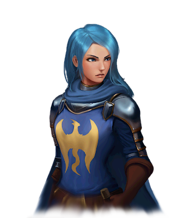
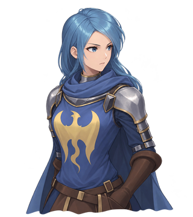
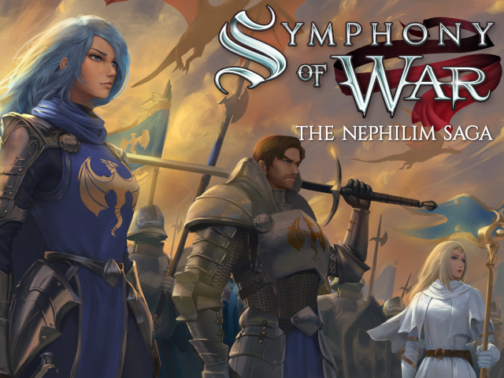
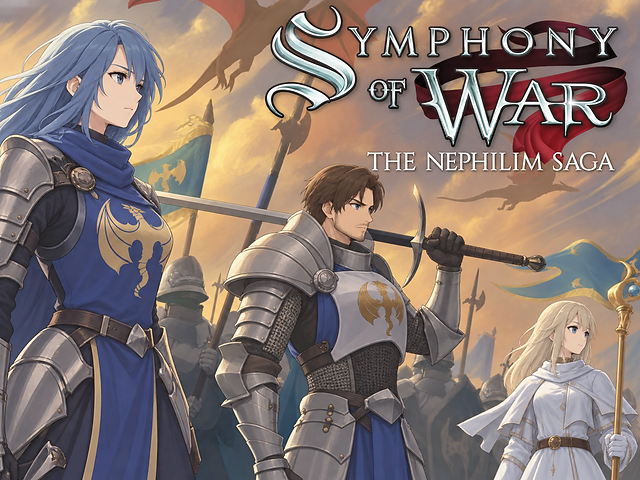
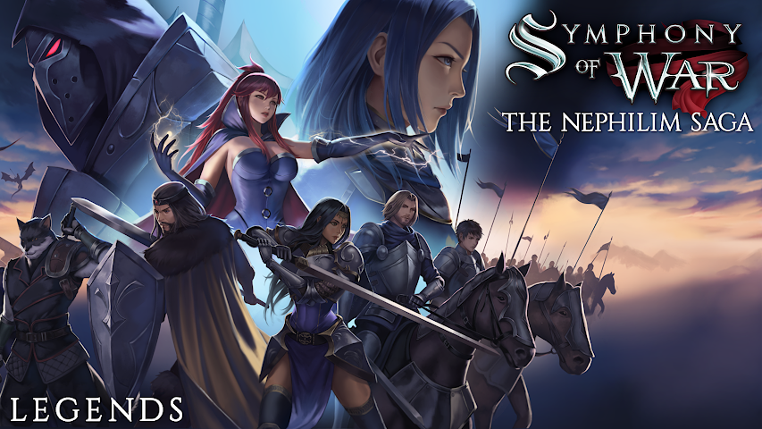
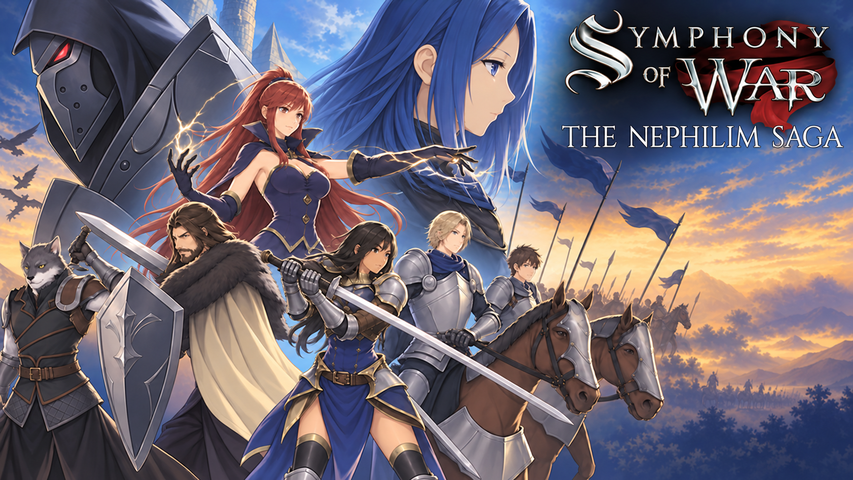

# Symphony Of War TA-KU mode 1.0.2

SymphonyOfWar의 JRPG 스타일의 일러스트 변경 및 보이스 추가 모드입니다.

<table>
<tr><td></td><td></td></tr>
<tr><td></td><td></td></tr>
<tr><td></td><td></td></tr>
</table>

## 1.0.2 변경 사항

변경 사항
- 일러스트 위치 조정
- 원본 캐릭터의 나이와 맞지않는 묘사에 대한 수정

버그 수정
- 일반판에서 동작하지 않는 문제 수정

설치 시 일반판 / LEGENDS 원본을 자동 판단해 적용합니다.

## 다운로드

**[최신 버전 다운로드](https://github.com/greedThread/takumode_symphony_of_war/releases/latest)**

Releases의 `TA-KU-mode-1.0.2.zip`을 받으세요. `Source code` 파일은 설치 패키지가 아닙니다.

## 설치 및 업데이트

지원 버전: **1.10.23 일반판(DLC 없음) / LEGENDS**. 원본 게임이 필요합니다.

1. 게임을 종료하고 ZIP을 모두 압축 해제합니다.
2. `TA-KU-mode-Installer.exe`를 실행합니다.
3. `Game.rgss3a`가 있는 게임 폴더를 선택합니다.
4. 일러스트 변경(512개)과 일본어 음성 변경(64개) 중 원하는 항목을 선택합니다.
5. **선택 항목 설치**를 누르고 완료될 때까지 기다립니다.

기존 사용자도 같은 방법으로 업데이트합니다. 기존 1.0.0 일러스트 설치는 원본 백업을 유지한 채 갱신합니다. **이전에 적용한 항목을 체크 해제하고 설치하면 해당 항목이 원본으로 복원됩니다.**

## 복원 및 참고

- 설치기의 **모두 원본 복원**을 사용하거나, 복원할 항목을 체크 해제하고 설치하세요.
- 설치 프로그램, `assets`, `manifest.json`, `CREDITS.txt`를 함께 보관하세요.
- Steam 파일 검사 또는 게임 업데이트 후에는 모드를 다시 설치해야 합니다.
- 다른 모드가 같은 파일을 변경한 경우 설치가 중단됩니다.
- 저장 파일과 게임 스크립트는 변경하지 않습니다.
- 일본어 음성은 VOICEVOX 합성 음성입니다. 상세 크레딧은 패키지의 `CREDITS.txt`를 확인하세요.

## 향후 방향

- 지속적인 리소스 조정 및 리터칭 예정
- 도트 및 시각 효과 개선

현재까지는 AI만을 사용하여 제작했습니다. 추후 직접 리터칭하거나 수정할 예정이지만, 빠른 대응은 어려울 수 있습니다.

## 버그 및 문의

일부 일러스트가 깨지거나 동작 버그가 발생하면 문제 제보 부탁드립니다.

이미지나 캐릭터 명을 알려주시면 더 빠르게 확인 대응이 가능합니다. 감사합니다.

[문제 제보](https://github.com/greedThread/takumode_symphony_of_war/issues) · 문의 이메일: [greed.thread@gmail.com](mailto:greed.thread@gmail.com)
